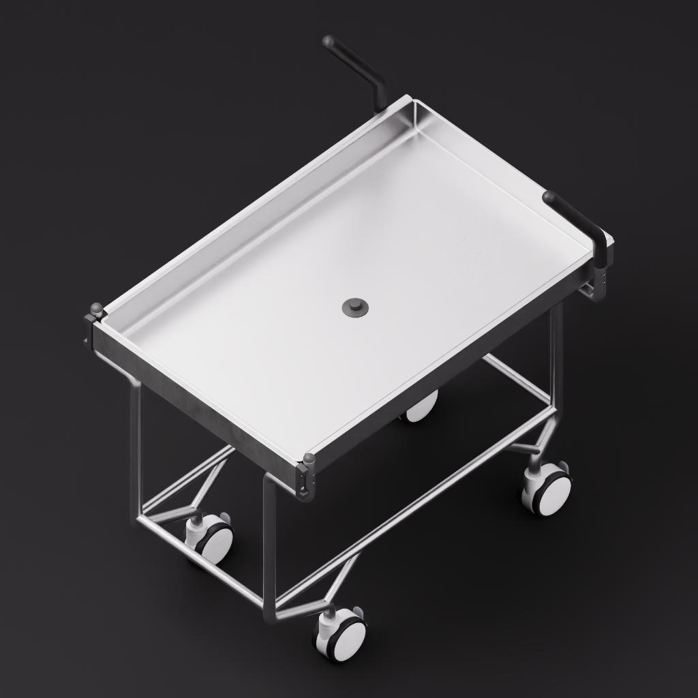

# 3D Asset Agent Skills

**Find a reusable 3D model before building from scratch.**

Agent skills to search, preview, and download free 3D models, then help an AI agent adapt a selected asset to your idea. The current skill brings together NVIDIA SimReady Central and Scenario, with source-aware search, real preview images, license information, complete download helpers, and modeling handoffs.

We plan to add **more trusted sources of high-quality, freely accessible 3D models** over time. Each new source will be evaluated for clear provenance and licensing, model quality, useful previews and metadata, and reliable downloads.

## What you can do

- Describe an idea and find existing models that could serve as a starting point.
- Compare real previews, source links, declared licenses, and estimated download sizes.
- Download selected models with their package files, available dependencies, and attribution information.
- Verify available SHA-256 hashes and retry failed downloads without replacing differing local files.
- Generate a modeling handoff with the source version, local entry files, requested changes, and checks for the next AI agent.
- Adapt the selected asset using an available 3D application or tool connection.

Discovery and download require **Python 3.10+** and use only the standard library. The scripts do not add an account, login cookie, or API key to public requests. Actual model editing requires a compatible application such as Blender.

## Current model sources

| Source | Role | Search and usage notes |
| --- | --- | --- |
| [NVIDIA SimReady Central](https://huggingface.co/spaces/nvidia/simready-central) | Primary catalog | Hybrid text/vector search across participating datasets, including NVIDIA assets and other registered providers. |
| [NVIDIA simready-assets](https://huggingface.co/datasets/nvidia/simready-assets) | Availability fallback | Used automatically only when Central cannot be reached. It is not searched again to expand a successful Central search. |
| [Scenario 3D Collection](https://huggingface.co/datasets/scenario-labs/3d-collection) | Supplementary source | Used when suitable primary candidates are missing or insufficient. Keyword search uses original prompt metadata; styles require visual review. |

### Source routing

    Central responds normally
      -> use its suitable candidates
      -> search Scenario if the target is missing or more alternatives are needed

    Central cannot be reached
      -> reuse available Central cache
      -> use the NVIDIA repository as an availability fallback
      -> search Scenario if suitable candidates are still missing or insufficient

Scenario additions stay after valid primary candidates. A result count alone does not prove relevance: the agent must inspect previews and judge the object, silhouette, and style against the user's idea.

### Example previews

| NVIDIA SimReady example | Scenario supplementary example |
| --- | --- |
|  |  |

These examples illustrate different source styles. Preview credits, pinned source links, and licenses are listed in [image attribution](docs/images/ATTRIBUTION.md).

## Use the skill

The included skill is [simready-3d-assistant](simready-3d-assistant/SKILL.md).

Clone this repository and add the simready-3d-assistant folder to your agent's supported skill directory. You can also ask an agent to read its SKILL.md directly. A ready-to-copy archive is available at [dist/simready-3d-assistant.zip](dist/simready-3d-assistant.zip).

    git clone https://github.com/jeak01/3d-asset-agent-skills.git
    cd 3d-asset-agent-skills

Example request:

    Use $simready-3d-assistant to find models that I could adapt into a sci-fi
    maintenance cart. Show real preview images, licenses, and download options
    first. After I choose an asset, help me adapt it in Blender.

The skill asks for an asset choice before downloading a full model package unless you have already selected a specific asset.

## Command-line quick start

### Find and compare candidates

    python simready-3d-assistant/scripts/simready.py search --query "mobile cart" --intent "A sci-fi maintenance cart" --limit 5 --out ./candidates

The search writes a gallery.html comparison page, a candidates.md list, a results.json metadata report, and available images in previews/. Results include source links, declared licenses, pinned versions, estimated sizes, and retrieval details.

The cache defaults to .simready-cache in the current directory. Use --cache-dir to choose another location and --offline to reuse previously cached metadata.

### Use Scenario for supplementary candidates

The agent should simplify the idea to a concrete object and provide useful English synonyms. Material and style preferences are kept separate from the core object query.

    python simready-3d-assistant/scripts/simready.py search --source scenario --query "cart" --scenario-keyword "trolley" --scenario-keyword "handcart" --style "low-poly" --out ./supplement

The --scenario-keyword and --scenario-exclude options are repeatable. Matching uses word boundaries, singular/plural normalization, controlled synonyms, compound phrases, and subject/context weighting. It does not assume semantic understanding of images or infer object names from hashed filenames.

### Inspect and download a selected asset

Replace SOURCE_URL with a returned candidate's source URL.

    python simready-3d-assistant/scripts/simready.py inspect --asset-url "SOURCE_URL" --out ./package-plan.json
    python simready-3d-assistant/scripts/simready.py download --asset-url "SOURCE_URL" --out ./downloads --zip

For SimReady, the downloader preserves the whole package folder, USD layers, textures, and license metadata. For Scenario, it preserves the example's output folder, associated input files, source README, and license. Downloads use a pinned repository commit and check available upstream hashes.

The default download budget is 512 MiB. Review the package estimate before increasing --max-mb. A failed download is recorded as incomplete and is not presented as a ready package.

### Prepare a modeling handoff

    python simready-3d-assistant/scripts/simready.py handoff --manifest "downloads/PACKAGE/download-manifest.json" --idea "Add enclosed tool storage and change the cart to a sci-fi style" --target Blender --out ./modeling-handoff.md

The handoff includes verified local source files, provenance, the declared license, and adaptation checks. It does not execute Blender or claim that editing, rendering, or export has already happened.

See the [service reference](simready-3d-assistant/references/services.md), [Scenario search guide](simready-3d-assistant/references/scenario.md), and [adaptation guide](simready-3d-assistant/references/adaptation.md) for details.

## More trusted, high-quality free model sources

This project is designed to grow beyond its current integrations. We intend to add more trusted sources of high-quality free 3D models while keeping source selection understandable and model reuse practical.

We will evaluate prospective sources for:

- **Provenance and trust:** identifiable publishers and traceable original files.
- **Licensing clarity:** readable terms, explicit attribution requirements, and clear reuse restrictions.
- **Model quality:** useful geometry, materials, textures, and suitability for the source's stated purpose.
- **Discoverability:** meaningful descriptions, reliable previews, and searchable metadata.
- **Download reliability:** stable file access, version information, and integrity checks where available.
- **Workflow fit:** formats and package structures that support inspection and adaptation.

Future additions will retain their own source identities, priorities, licenses, and quality notes. A freely accessible download does not automatically grant unrestricted commercial use. Source suggestions are welcome through GitHub issues; include the source URL, licensing information, and representative examples.

## Licensing and practical limits

- Default discovery admits resources declaring CC-BY-4.0 or CC0-1.0 with the relevant license file present. The --license-policy any option permits reviewing other declared licenses; it does not remove their restrictions.
- Scenario requires credit to **Scenario**. The skill preserves that attribution in its download manifest and attribution draft.
- Source declarations are not a guarantee of rights clearance. Check attribution, trademarks, and other applicable rights before publishing derivatives.
- Central covers registered and indexed content; search results and service availability can change.
- Scenario's styles vary. As checked on October 26, 2026, 370 of its 1,342 records contained textual prompts; the other 972 are not reliably discoverable through this keyword index. Current coverage is reported by the script.
- Complete package retrieval is separate from application-level validation. Unsupported shaders, missing external references, format conversion, and binary dependencies still require inspection in the target application.
- Scenario examples do not declare SimReady physics/profile validation. Changes to SimReady geometry may require revalidating collisions, mass, joints, and metadata.
- Open .blend files with automatic script execution disabled. Downloaded assets and metadata are treated as data, not instructions.

## Development and validation

Run the dependency-free behavior tests from the repository root:

    python -m unittest discover -s tests -v

Tests cover source routing, successful empty searches versus outages, cached results, keyword behavior, licensing filters, pinned metadata, package integrity, ZIP contents, local-file protection, and modeling handoffs. They run without querying live providers.

Live checks on October 26, 2026 covered Central search, NVIDIA fallback search, Scenario previews, offline reuse, complete downloads from both source families, hash checks, ZIP creation, and handoff generation. Blender import, model modification, rendering, and export were not part of those checks.

## Project license

The original code and skill instructions in this repository are released under the [MIT License](LICENSE). Downloaded models and third-party preview images retain their respective upstream licenses. This repository does not bundle the model collections and is not affiliated with or endorsed by NVIDIA, Scenario, or Hugging Face.
